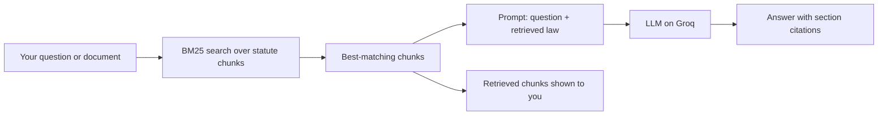

<div align="center">

# The Suit Co.

**The Law Doesn't Wait. Neither Should You.**

Legal and tax research for India, grounded in real statutory text. Ask a question and get an answer built from the Acts themselves, with the retrieved sections listed right next to it.


</div>

---

## The problem

A language model answering a legal question from memory can cite a section that doesn't exist, quote a provision that was amended last year, or name a judgement nobody delivered. In law, a confident wrong answer is worse than no answer.

## The approach

The Suit Co. is built on Retrieval-Augmented Generation. Before the model writes anything, a BM25 retrieval engine searches a knowledge base of 67+ statutory chunks and pulls the passages that match the question. The model then answers from that text.



Statutes are full of exact terms and section numbers, which is the kind of text keyword retrieval handles well. And because the retrieved chunks are shown with every response, you can see what the model was given and check its work.

## What's in the box

| Module | What you get |
|---|---|
| Legal Research | Answers grounded in retrieved law, with exact section citations |
| Document Analysis | Upload a GST or Income Tax notice or a contract. Get a risk score, a clause-by-clause breakdown, and a downloadable brief |
| Case Law | AI-suggested judgements for your topic, each linked to Indian Kanoon so you can read the real thing |
| Compliance Checker | Paste any legal document and get a structured action checklist |
| Plain English | Statutory language translated into clear explanations that stay accurate |
| Harvey Mode | Legal strategy, delivered with conviction |


## The knowledge base

Real statutory text, chunked and indexed:

- CGST Act 2017, including Finance Act 2025 amendments
- Income Tax Act 2025 (in force from April 2026) and Income Tax Act 1961 (AY 2026-27 and earlier)
- Companies Act 2013
- Indian Contract Act 1872
- Insolvency and Bankruptcy Code 2016
- RERA
- FEMA
- SEBI regulations
- Arbitration Act
- and more

## Try these

```
What are penalties for ITC mismatch under GST?
Explain the moratorium under the IBC in plain English.
What does the Companies Act 2013 say about related party transactions?
```

For Document Analysis, paste a Section 143(1) intimation and check that the demand, the due date and the evidence quotes match the document line for line. If the document gives no deadline for something, the app should say so instead of inventing one.

## Run it locally

You need Node.js 18.18 or newer and a free Groq API key from [console.groq.com/keys](https://console.groq.com/keys).

```bash
git clone <your-repo-url>
cd <repo-folder>
npm install
```

Create `.env.local` in the project root:

```
GROQ_API_KEY=your_key_here
```

Then start it:

```bash
npm run dev
```

Open [http://localhost:3000](http://localhost:3000). If `npm install` complains about peer dependencies, use `npm install --legacy-peer-deps`.

The model name lives in `lib/gemini.ts` (the filename is left over from an earlier version, and the file calls Groq). The app currently runs `openai/gpt-oss-120b`. Groq retires models now and then, so if you see "model does not exist", check [console.groq.com/docs/models](https://console.groq.com/docs/models) and update the string.

## Built with

Next.js (App Router), TypeScript, Tailwind CSS, shadcn/ui, BM25 retrieval, and the Groq API.

## Where it can still be wrong

Retrieval narrows what the model draws on. It does not make the model infallible.

- The model can still misread a chunk it was given.
- A question outside the knowledge base has little law to retrieve, so the answer has less grounding.
- Case law results are AI-suggested. Treat each one as a lead and the linked Indian Kanoon page as the source. Outputs are anonymised and structured for research assistance.
- Document Analysis is instructed to state only dates and deadlines that appear in the document. Check them against the original anyway.

The Suit Co. is a research aid. It is not legal advice, and it does not replace a lawyer or a chartered accountant.

## Author

Built by Aditi.
